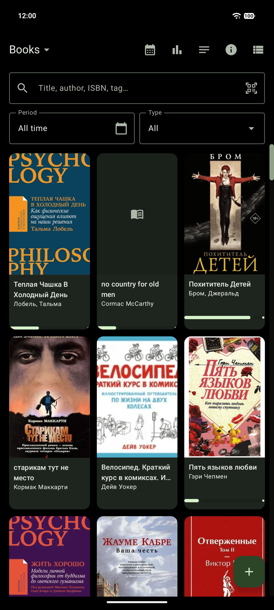
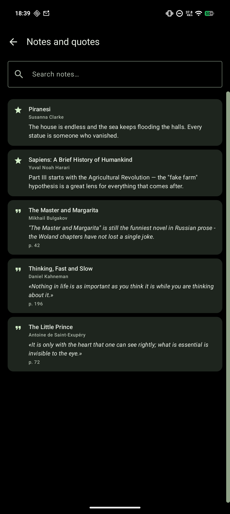
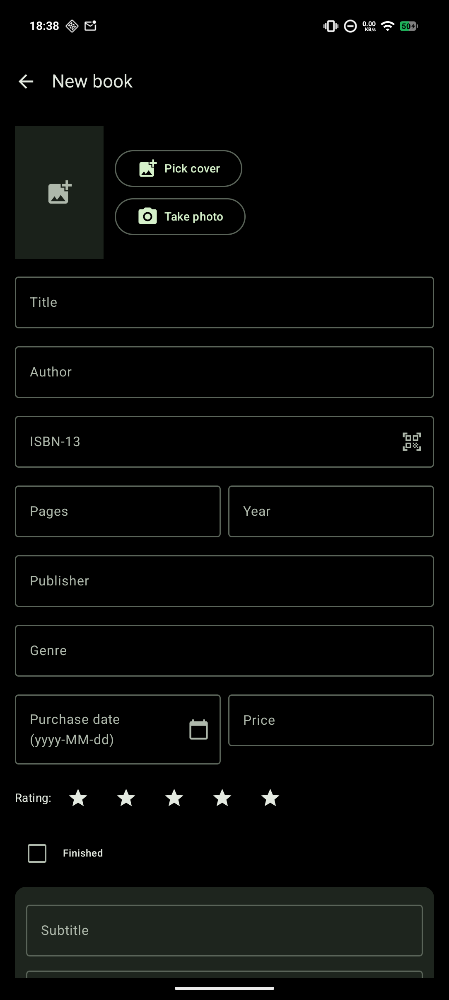

# kwbooktrack

Offline tracker for your personal library of **books and movies**. No account, no ads,
no analytics, no internet permission — everything lives in a local Room database on
the device.

## Features

**Library**

- Books: author, ISBN, pages, publisher, year, genre, language, series, binding,
  condition, annotation, cover (gallery or camera), purchase date and price,
  gift / lent / sold flags
- Movies: director, cast, country, year, genres, duration, link, watch date,
  rating, comments
- Search by title, author, ISBN and tags; filters by status and purchase period;
  list or grid view
- ISBN barcode scanning with the camera to pre-fill a book card
- Tags for books and movies, shared across the collection

**Reading log**

- Reading sessions with current page and dates, time spent
- Progress in pages and percent, pages left

**Notes, quotes and reviews**

- Notes, quotes and reviews with an optional page reference and attached photos
- One searchable notes list, filtered by type
- Markdown rendering in reviews and notes

**Statistics and calendar**

- Pages read, books finished, books bought and money spent — per month and per year
- Movies watched and time spent watching
- Reading calendar by day, showing book covers or page counts

**Import and export**

- ZIP backup and restore with CSV, covers and photos
- Native Tellico format (`.tc`) import and export
- Import of Tellico XML and CSV exports

**Other**

- Light and dark theme, or follow the system
- Russian and English interface

## Screenshots

| | | |
|---|---|---|
|  |  |  |
|  |  |  |

The same set is kept in Russian under `fastlane/metadata/android/ru/images/phoneScreenshots/`
Switch the interface language in the app: About → Interface language → English.

## Support the author

- Boosty — <https://boosty.to/kvanton/donate>
- Dalink — <https://dalink.to/ant0nk>

Crypto (tap an address in the app's About screen to copy it):

| Network | Assets | Address |
|---|---|---|
| Bitcoin | BTC | `bc1qr0m6alqjk9zzy29ma0wpz66uas0dyrxy9hdr7a` |
| Ethereum | ETH / USDT / USDC | `0x9a68188c912c70fa4eecb7aaf651c7318047b2a2` |
| Polygon | POL / USDT / USDC | `0x9A68188C912c70Fa4EeCB7AAF651C7318047b2A2` |
| Solana | SOL / USDT / USDC | `ck5YP1JW8hhoMnxdUWPUVnkRNEZWD3EQVJjm33Ec9ma` |

## Tech stack

Kotlin, Jetpack Compose, Material 3, Hilt, Room, Markwon, Coil. `minSdk` 31.

## License

GNU General Public License v3 — see [LICENSE](LICENSE).

## Publishing

F-Droid builds from the [kwbooktrack-fdroid](https://github.com/KVAnton-WEB/kwbooktrack-fdroid)
mirror: the steps are in [docs/fdroid.md](docs/fdroid.md) and the ready metadata file for
`fdroiddata` is [docs/fdroid/ru.antonkw.kwbooktrack.yml](docs/fdroid/ru.antonkw.kwbooktrack.yml).

## Build

    ./gradlew assembleDebug

Minified build (R8 + shrinkResources):

    ./gradlew assembleRelease
    # app/build/outputs/apk/release/app-release.apk (~4 MB instead of ~64)

## Tests

    ./gradlew test

