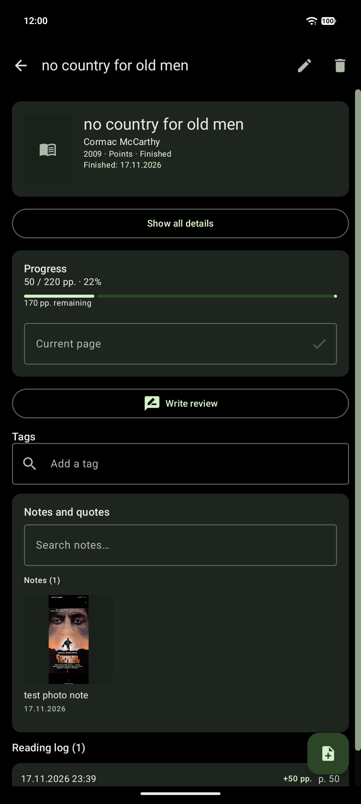
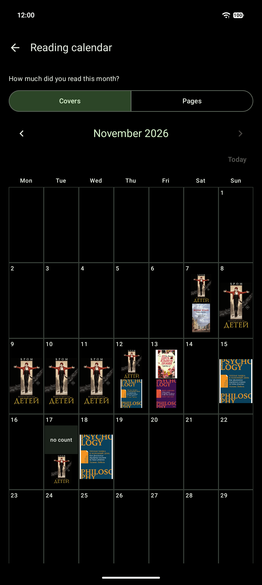
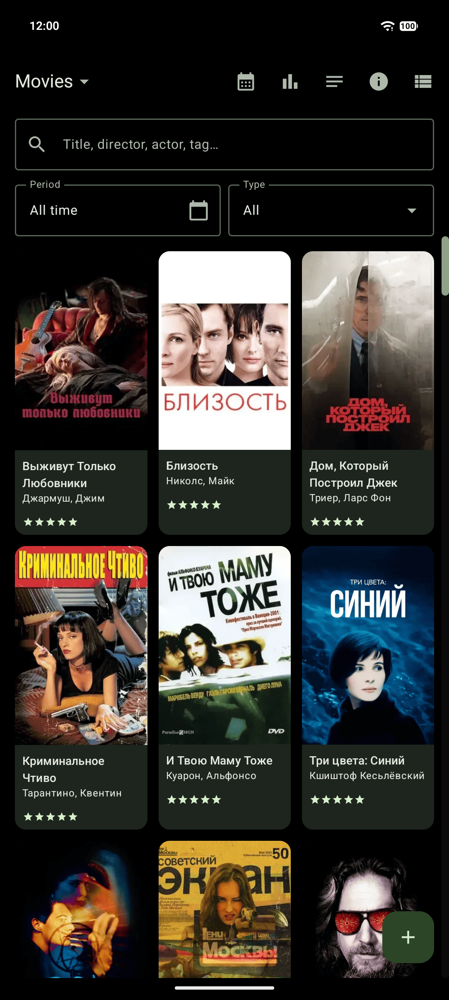

# kwbooktrack

Offline tracker for your personal library of **books and movies**. No account, no ads,
no analytics, no internet permission — everything lives in a local Room database on
the device.

## Features

**Library**

- Books: author, ISBN, pages, publisher, year, genre, language, series, binding,
  condition, annotation, cover (gallery or camera), purchase date and price,
  gift / lent / sold flags
- Movies: director, cast, country, year, genres, duration, link, watch date,
  rating, comments
- Search by title, author, ISBN and tags; filters by status and purchase period;
  list or grid view
- ISBN barcode scanning with the camera to pre-fill a book card
- Tags for books and movies, shared across the collection

**Reading log**

- Reading sessions with current page and dates, time spent
- Progress in pages and percent, pages left

**Notes, quotes and reviews**

- Notes, quotes and reviews with an optional page reference and attached photos
- One searchable notes list, filtered by type
- Markdown rendering in reviews and notes

**Statistics and calendar**

- Pages read, books finished, books bought and money spent — per month and per year
- Movies watched and time spent watching
- Reading calendar by day, showing book covers or page counts

**Import and export**

- ZIP backup and restore with CSV, covers and photos
- Native Tellico format (`.tc`) import and export
- Import of Tellico XML and CSV exports and of libraries from other trackers

**Other**

- Light and dark theme, or follow the system
- Russian and English interface

## Screenshots

| | | |
|---|---|---|
|  |  |  |
|  |  |  |

The same set is kept in Russian under `fastlane/metadata/android/ru/images/phoneScreenshots/`
and is what F-Droid shows. To reshoot:

    adb shell am start -n ru.antonkw.kwbooktrack/.MainActivity
    adb exec-out screencap -p > fastlane/metadata/android/ru/images/phoneScreenshots/1.png

Switch the interface language in the app: «О приложении» → «Язык интерфейса» → English.

## Support the author

- Boosty — <https://boosty.to/kvanton/donate>
- Dalink — <https://dalink.to/ant0nk>

Crypto (tap an address in the app's About screen to copy it):

| Network | Assets | Address |
|---|---|---|
| Bitcoin | BTC | `bc1qr0m6alqjk9zzy29ma0wpz66uas0dyrxy9hdr7a` |
| Ethereum | ETH / USDT / USDC | `0x9a68188c912c70fa4eecb7aaf651c7318047b2a2` |
| Polygon | POL / USDT / USDC | `0x9A68188C912c70Fa4EeCB7AAF651C7318047b2A2` |
| Solana | SOL / USDT / USDC | `ck5YP1JW8hhoMnxdUWPUVnkRNEZWD3EQVJjm33Ec9ma` |

## Tech stack

Kotlin, Jetpack Compose, Material 3, Hilt, Room, Markwon, Coil. `minSdk` 31.

## License

GNU General Public License v3 — see [LICENSE](LICENSE).

## Publishing

- F-Droid: метаданные и пошаговая инструкция — [docs/fdroid.md](docs/fdroid.md),
  готовый файл для `fdroiddata` — [docs/fdroid/ru.antonkw.kwbooktrack.yml](docs/fdroid/ru.antonkw.kwbooktrack.yml).
- RuStore: требования, отдельный набор иконки и скриншотов и порядок подачи —
  [docs/rustore.md](docs/rustore.md).

## Build

    ./gradlew assembleDebug

Облегчённая сборка (R8 + shrinkResources):

    ./gradlew assembleRelease
    # app/build/outputs/apk/release/app-release.apk (~4 МБ вместо ~64)

Подпись release-сборки берётся из `keystore.properties` в корне репозитория
(файл в `.gitignore`):

    storeFile=kwbooktrack-release.jks
    storePassword=...
    keyAlias=kwbooktrack
    keyPassword=...

Без этого файла release подписывается debug-ключом — для локальных проверок,
но не для публикации: ни RuStore, ни обновления такое приложение не примут.

## Tests

    ./gradlew test

## Contributing — version discipline

Every commit must bump the app version. A `pre-commit` hook enforces this:
both `versionName` and `versionCode` in `app/build.gradle.kts` must change
relative to the previous commit. The first commit of a brand-new clone is
exempt.

Enable once per clone:

    git config core.hooksPath hooks

If the hook blocks you, do the bump it asks for. For deliberate no-bump
commits (rebase, doc-only), use `git commit --no-verify`.

Self-check the hook locally:

    bash hooks/test-pre-commit.sh

### Как нумеровать версии в ветках

Две вещи, которые F-Droid и Play считают разными:

- **`versionCode`** — целое число, порядковый номер сборки. Новая опубликованная
  версия должна иметь код **больше** предыдущей, а коды разных сборок не
  должны совпадать. Именно по коду F-Droid понимает, что версия новее, и по
  коду же называется changelog.
- **`versionName`** — строка для человека (показывается в «О приложении»).
  Всё, что не мешает сортировке, — можно.

**Коды — одна сквозная нумерация на весь репозиторий.** Новое значение =
максимум по всем веткам + 1:

    git log --all --format=%h -- app/build.gradle.kts

Две ветки, начавшиеся от одного коммита, нумеруют коды независимо и
схлопываются: в этом репозитории `main` занял коды 71–86, а
`feature/isbn-lookup` — те же 71–83, но с другими сборками. Поэтому перед
бампом берём максимум по всем веткам, а не «последний в своей».

**`versionName` на ветке — с суффиксом.** Без суффикса сборка ветки
неотличима от релиза, и при слиянии в `main` пришлось бы гадать, какая из
них «настоящая». Формат:

    0.8.0            — релиз из main
    0.8.0-lookup.1   — сборка ветки фичи: базовая версия + суффикс ветки
    0.8.0-lookup.2   — следующая сборка той же ветки

Суффикс идёт **после** версии, а не перед: так строка остаётся разбираемой
парсерами, которые ждут цифры в начале (сортировка, F-Droid), и по
смыслу пре-релиз сортируется раньше релиза.

**Релиз из `main`** — всегда без суффикса: `0.8.0`, дальше `0.8.1`. Публикуем
только из `main` (F-Droid собирает по тегу), поэтому суффиксные сборки в
метаданных F-Droid не попадают.

Changelog лежит в `fastlane/metadata/android/<locale>/changelogs/` и
называется **кодом сборки**: `87.txt` — это changelog сборки с кодом 87, а не
«версии 0.8.7». Код релиза известен только на `main` — файл переименовываем
в момент релиза.