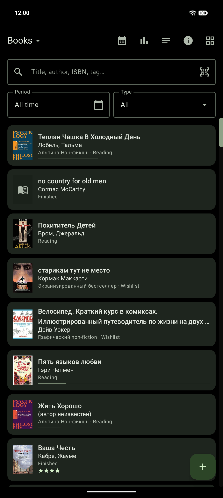
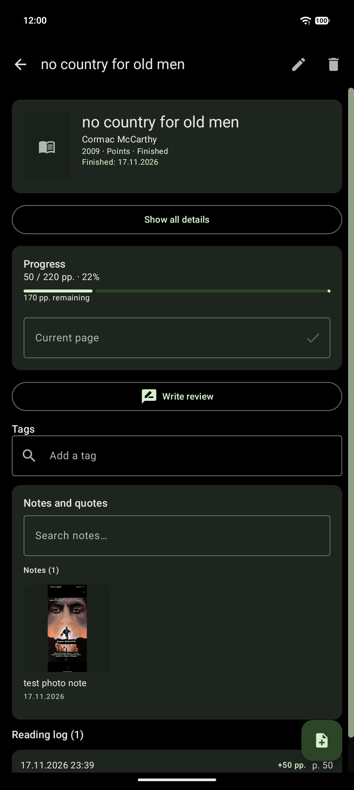
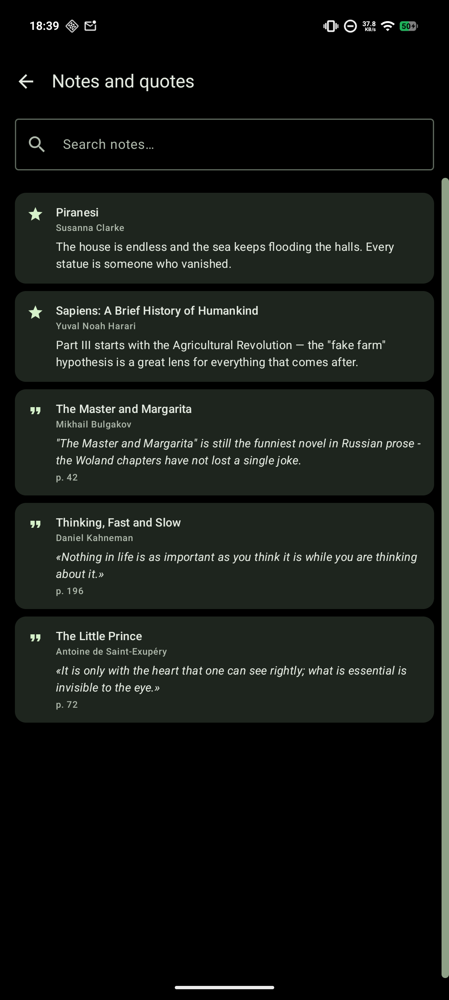

<!--
MR title: New app: kwbooktrack
Source: KVAnton.WEB1/fdroiddata, branch ru.antonkw.kwbooktrack -> fdroid/fdroiddata master

Open no earlier than 2026-12-29: Inclusion Policy Quality point 6 requires at least
3 months of active development; the project started 2026-09-29.

Before opening:
1. If a newer release exists, update metadata/ru.antonkw.kwbooktrack.yml in the fork
   (keep only the latest version, full commit hash) and sync docs/fdroid/submit/.
2. Push the branch, wait for a green pipeline and check the Reports tab.
3. Paste everything below this comment as the MR description.
-->

## Abstract for new app inclusion

**kwbooktrack** is an offline manager for a personal book and movie collection: a home library catalogue, reading log, notes and statistics. No account, no ads, no analytics, no INTERNET permission — everything stays in a local Room database on the device. GPL-3.0-only, Russian and English interface, light/dark theme.

What it does and how it is used:

- **Collection catalogue.** Books with library-grade fields: author, original title, subtitle, ISBN, page count, publisher, year, print year, genre, language and original language, translator, series, binding, condition, annotation, plus owner flags (gift, lent out, sold) and purchase date/price/place. Movies with director, cast, country, year, genres, duration. Covers from gallery or camera, ratings, tags, arbitrary extra fields. ISBN barcode scanning pre-fills a book card. Search by title/author/ISBN/director/actor/tags, filters by status and purchase period, grid or list view.
- **Reading log.** Sessions with current page, dates and time spent; progress in pages and percent.
- **Notes, quotes and reviews** with optional page reference and attached photos, Markdown rendering, one searchable list.
- **Statistics and calendar.** Pages read, books finished, books bought and money spent per month/year; movies watched and time spent; reading calendar by day.
- **Tellico compatibility.** Import and export in the native Tellico format (`.tc`) in both directions, plus `tellico.xml` and Tellico CSV import — move a collection between the phone and the [Tellico](https://tellico-project.org/) desktop catalogue.
- **Backups.** ZIP export/restore with CSV, covers and photos.

Screenshots (all 8 in the [upstream fastlane folder](https://github.com/KVAnton-WEB/kwbooktrack-fdroid/tree/main/fastlane/metadata/android/en-US/images/phoneScreenshots)):

**Why I wrote this app.** I keep my home library (600+ books, including second-hand and antiquarian editions) and my movie collection (100+) in Tellico on the desktop, and I wanted the same catalogue on my phone — fully offline, with the data moving back and forth without loss. I use the app daily. The book trackers already in F-Droid ([Openreads](https://f-droid.org/en/packages/software.mdev.bookstracker/), [Badreads](https://f-droid.org/en/packages/com.timenotclocks.bookcase/)) are reading-progress trackers; none of them catalogues a physical collection the way library software does, and none talks to Tellico.

**Unique value over similar apps in F-Droid:**

- Native Tellico `.tc` import/export — no other app in the repository bridges a phone catalogue with the Tellico desktop catalogue.
- Books **and movies** in one collection manager.
- Bibliographic and owner fields (original title, translator, print year, binding, condition, gift/lent/sold, purchase info) aimed at cataloguing a home library, not just logging what was read.
- Fully offline by design: the app has no INTERNET permission at all, while existing trackers rely on online lookup (e.g. Open Library in Openreads).

Build note: the upstream development repository is private, so `SourceCode`/`IssueTracker`/`Changelog` point at the public mirror `kwbooktrack-fdroid`, which contains the full history and release tags; details are in `MaintainerNotes`. Verified locally with `fdroid lint` (clean) and `fdroid build --test` (successfully built `ru.antonkw.kwbooktrack:115` from `462c40dc148e3a2d3d21b239ed3e93406e173413`, unsigned APK as expected).

This resubmits !58024, which was closed because the description did not follow the MR template and the 3-month development threshold had not been reached yet. This MR follows the template and is opened after that threshold (development started 2026-09-29, regular releases since then — see the changelog).

## Checklist

### Policy

* [x] The app complies with the [inclusion policy](https://f-droid.org/docs/Inclusion_Policy). _Pay special attention to Quality point 6._ — Actively developed since 2026-09-29 with regular releases; this MR is opened after 2026-12-29, when the 3-month threshold of Quality point 6 is met. No tracking, ads or analytics; no INTERNET permission. The `Donate` and `Bitcoin` links in the metadata are my own.
* [x] The original app author has been notified (and does not oppose the inclusion). — I am the original author.
* [x] The upstream app source code repo contains the app metadata in a [Fastlane](https://gitlab.com/snippets/1895688) or [Triple-T](https://gitlab.com/snippets/1901490) folder structure. — [`fastlane/metadata/android/{en-US,ru}`](https://github.com/KVAnton-WEB/kwbooktrack-fdroid/tree/main/fastlane/metadata/android) in the source repo: title, summary, full description, icon, 8 phone screenshots per locale and per-versionCode changelogs (including 115). `en-US` is included.

### Docs

* [x] Please read [the guide](https://gitlab.com/fdroid/fdroiddata/-/blob/master/CONTRIBUTING.md) first if this is your first contribution.
* [x] Please make sure your metadata follows the best practice in [our templates](https://gitlab.com/fdroid/fdroiddata/tree/master/templates).
* [x] Please read the [Build Metadata Reference](https://f-droid.org/docs/Build_Metadata_Reference/) and make sure your metadata is valid. — `fdroid lint` passes, also inside a real fdroiddata clone.
* [x] Please read the [Quick Start Guide](https://f-droid.org/en/docs/Submitting_to_F-Droid_Quick_Start_Guide/).

### Merge Request Setup

* [x] The title of this merge request should follow "New app: app name" format. — "New app: kwbooktrack".
* [x] Please make sure your fdroiddata fork is public and your branch is not protected.
* [x] Please read [our Git guide](https://gitlab.com/fdroid/wiki/-/wikis/Tips-for-fdroiddata-contributors/Git-Usage) if you don't know how to rebase your branch. Don't rebase your branch if there is no conflict.
* [x] All related [fdroiddata](https://gitlab.com/fdroid/fdroiddata/issues) and [RFP issues](https://gitlab.com/fdroid/rfp/issues) have been referenced in this merge request — there is no RFP issue for this app; the previous MR !58024 is referenced above.
* [x] Please only submit one app in one MR.

### Metadata

* [x] Metadata must be put in `metadata/<applicationId>.yml`. — `metadata/ru.antonkw.kwbooktrack.yml`, the only file in this MR.
* [x] Metadata must be a valid YAML file.
* [x] Metadata must use LF as line ending.
* [x] Don't add summary/description/changelog/images or anything that should be provided in upstream repo. — all of that lives in the upstream fastlane folder; the Changes tab contains only the metadata file.
* [x] Releases are tagged and auto update is enabled unless there is a special reason. — tag `v0.9.5-fdroid.2`, `AutoUpdateMode: Version`, `UpdateCheckMode: Tags ^v[0-9.]+(-fdroid(\.[0-9]+)?)?$`.
* [x] There is an issue tracker and contact info of the author so that we can report bugs and contact the author. — `IssueTracker` and `AuthorEmail` are set.
* [x] An AuthorName must be added. It doesn't need to be the real name.
* [x] External repos are added as git submodules instead of srclibs. — no external repos/srclibs are used.
* [ ] Enable [Reproducible Builds](https://f-droid.org/docs/Reproducible_Builds). — Not enabled: there is no dedicated release keystore; local release builds are signed with the debug key, fdroidserver strips the `signingConfigs` block, so the build server produces an unsigned APK and F-Droid signs it with its own key. I understand the APK cannot be switched to my own signature later.
* [x] Setup abi split if the APK is large and the splitted ones can be much smaller. — the APK is ~4 MB (R8 + resource shrinking), no split needed.
* [x] Only the latest versions should be kept in the metadata before it's merged. — a single build: 0.9.5-fdroid.2 / 115.
* [x] Don't add any disabled versions in the metadata.
* [x] The `commit` field should be the full hash. Please don't use tag or branch in commit. — `462c40dc148e3a2d3d21b239ed3e93406e173413`.

### Pipeline

* [x] All pipelines should pass. — [latest pipeline on the branch](https://gitlab.com/KVAnton.WEB1/fdroiddata/-/pipelines/3086651798) is green.
* [x] All warnings and errors in the Reports tab should be fixed or explained.
* [x] F-Droid CI runners are under GitLab's FOSS program, so there's no need for you to pay for any CI time. If Gitlab starts asking for phone numbers or credit cards don't submit anything, just leave a note in the MR so we know we need to trigger the CI. — CI ran without any verification prompts.

---------------------

/label ~"New App"
